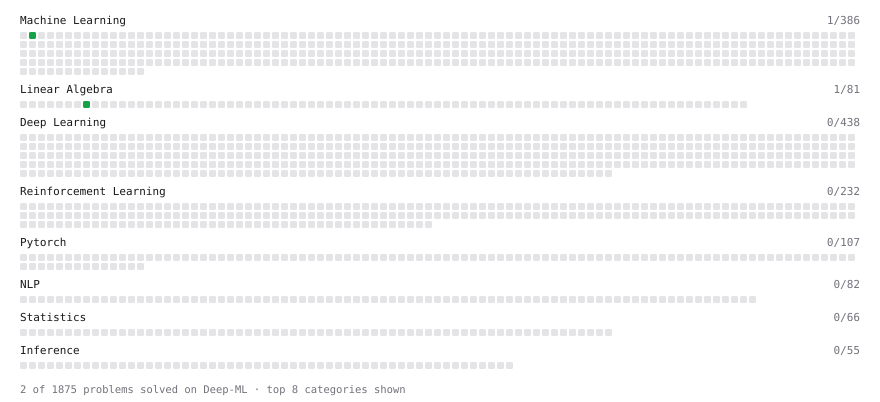

# Deep-ML

My machine learning practice from [Deep-ML](https://www.deep-ml.com). Every solution here was written by hand.

**5** solved · 5 problems · 0 labs · 0 math

[**Browse the interactive portfolio**](https://kimseolqwq.github.io/deep-ml/) to replay this filling in over time.

## Problems

| | Difficulty | Solved | |
| --- | --- | --- | --- |
| [Calculate 2x2 Matrix Inverse](https://www.deep-ml.com/problems/8) | easy | 2026-11-02 | [solution](problems/0008-calculate-2x2-matrix-inverse) |
| [Feature Scaling Implementation](https://www.deep-ml.com/problems/16) | easy | 2026-11-02 | [solution](problems/0016-feature-scaling-implementation) |
| [Implement Precision Metric](https://www.deep-ml.com/problems/46) | easy | 2026-11-02 | [solution](problems/0046-implement-precision-metric) |
| [Implement Recall Metric in Binary Classification](https://www.deep-ml.com/problems/52) | easy | 2026-11-02 | [solution](problems/0052-implement-recall-metric-in-binary-classification) |
| [Linear Regression Using Gradient Descent](https://www.deep-ml.com/problems/15) | easy | 2026-11-02 | [solution](problems/0015-linear-regression-using-gradient-descent) |

---

_This file is regenerated by Deep-ML on every push._
